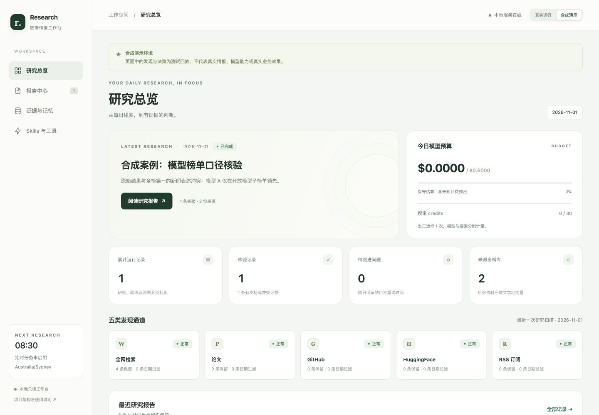
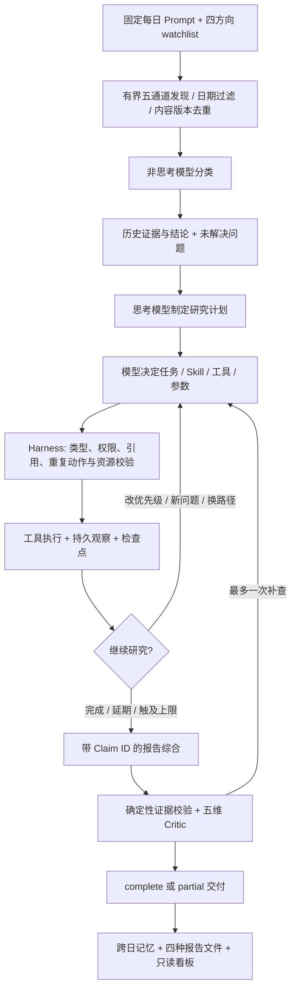
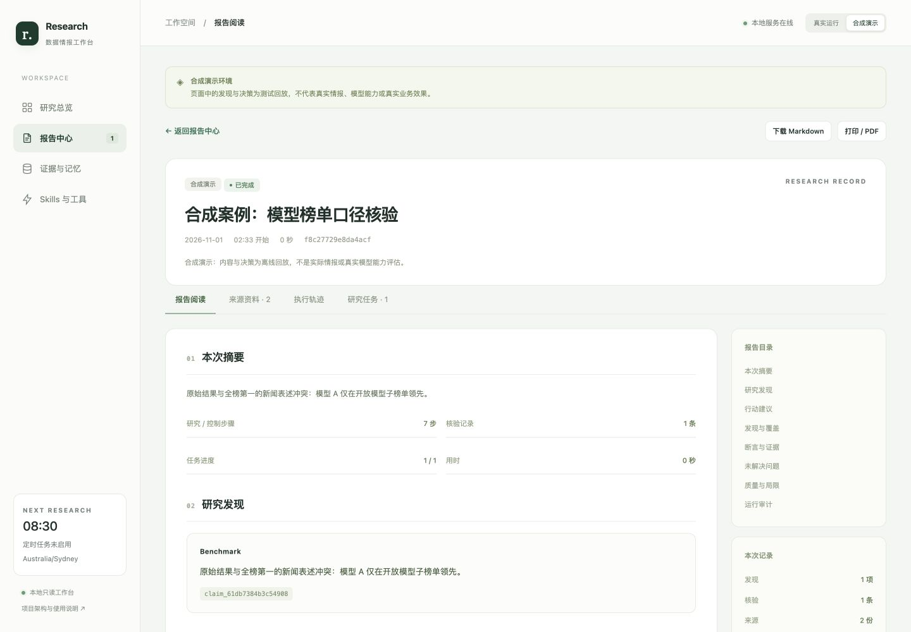

# Research Agent Harness · 每日数据情报 Agent

**固定目标，动态研究，证据可追溯。** 每日使用相同业务 Prompt，围绕 Benchmark、竞品、人才、供应商四个方向发现线索，由模型选择研究对象、方法、工具与停止时机，交付有引用的中文报告与 P0/P1/P2 数据储备建议。

这是独立的 Python 项目：单 Agent 控制循环 + 确定性 Harness，内置 7 个项目 Skills、17 个类型化工具、分层上下文、跨日记忆与本地只读看板。当前不依赖 LangGraph。



> 截图与 `examples/` 均为合成演示，不代表真实情报或模型准确率。完整线上日报仍受来源额度及模型质量约束，失败与未知会以 `partial` 保留。

## 导航

- [快速启动](#快速启动)：无凭据离线演示、真实运行、本地常驻
- [系统结构与完整目录树](docs/structure.md)：组件、执行时序、数据关系、部署结构
- [架构 / 上下文 / 记忆设计](docs/architecture.md)
- [Skills 与工具清单](docs/skills.md)
- [报告、看板与 API](docs/reports.md)
- [运维、预算与故障恢复](docs/operations.md)
- [验证结果与实际限制](docs/validation.md)
- [合成示例报告](examples/demo-report.md)

## 快速启动

需要 Python 3.12+ 与 [uv](https://docs.astral.sh/uv/)。命令均在仓库根目录执行。

### 1. 无 API Key 的离线演示

```bash
uv sync --frozen
uv run research-agent --config config/demo.yaml run --demo
uv run research-agent --config config/demo.yaml serve --demo
```

打开 **http://127.0.0.1:8765/**。演示使用确定性模型与合成来源，不联网取证、不下载向量模型、不产生模型费用。初次启动没有运行记录时，看板显示空状态；先运行 `run --demo` 即可生成示例。

### 2. 配置真实研究

```bash
cp .env.example .env
cp config/settings.yaml config/settings.local.yaml
# 在 .env 设置 DEEPSEEK_API_KEY、TAVILY_API_KEY；不要提交该文件
uv run research-agent doctor
uv run research-agent run
uv run research-agent serve
```

也可在 `.env` 中只设置 `AGENT_SECRETS_FILE=/absolute/path/to/existing/.env`，沿用既有密钥文件。环境变量优先；可选 `GITHUB_TOKEN`、`OPENALEX_API_KEY`、`HF_TOKEN` 用于相应来源。`doctor` 只报告配置是否存在，不发送付费探测。

配置读取顺序：`--config` → `AGENT_CONFIG` → `config/settings.local.yaml` → `config/settings.yaml`。相对数据路径以项目根目录为基准。便携默认配置关闭定时与向量下载，避免刚克隆就产生调用；确认预算后在本地配置启用 `schedule.enabled`。

可选的网页渲染与本地语义召回：

```bash
uv sync --frozen --extra browser --extra embeddings
PLAYWRIGHT_BROWSERS_PATH="$PWD/data/browsers" uv run playwright install chromium
```

然后设置 `memory.embedding_enabled: true`。首次使用 Qwen3 量化模型需要约 1.1 GB 下载与相应磁盘空间；未安装可选依赖时会报告不可用并使用可行的普通抓取 / FTS 路径。

### 3. macOS 本地常驻

```bash
uv run python scripts/service.py install
uv run python scripts/service.py status
```

安装器将运行副本放在 `~/Library/Application Support/ResearchAgentHarness`，将 LaunchAgent 放在当前用户目录，并让开发命令与服务共用数据库和预算账本。所需凭据保存在运行目录 `secrets.env`，权限为 0600；不写入 LaunchAgent。后续安装不会覆盖运行数据库。

启用调度后按配置时区执行，默认 Australia/Sydney 08:30。登录后常驻，异常退出自动重启；睡眠期间无法研究，恢复后补跑当天尚未创建的一次。退出登录或关机期间不能运行。Linux/Windows 可前台运行 `serve`，本仓库只实现 macOS 服务安装器。

## 系统如何工作



基线发现是固定覆盖；后续研究顺序由模型决定。它可以新增有界子问题、调整研究优先级、加载/卸载 Skill、更换取证来源、继续取证或延期；不能改预算、执行任意代码、安装远程 Skill、发消息或采购。

例如，新闻称“模型 A 全榜第一”：Agent 选择 `benchmark-verification`，调用 `fetch_page` 取得原文，以 `find_in_document` 定位排名表、`read_document` 读取上下文，再加载 `evidence-review` 并调用 `assess_claim`。若原始结果仅支持开放模型子榜领先，冲突进入思考模型裁决。原断言和反证一并保存，报告修正适用范围；版本仍缺失时调用 `defer_task`，留下下次要补的字段。

## 能力与边界

| 组成 | 已实现 |
| --- | --- |
| 发现来源 | Tavily 全网、OpenAlex 论文、GitHub 仓库、HuggingFace 论文/数据集、RSS |
| 深度取证 | 网页正文、论文 Markdown、原文定位与分页、受控浏览器读取与已观察控件交互 |
| Skills | 7 个本地维护的研究规程；元数据先可见，正文与参考材料按需加载，工具权限随加载状态校验 |
| 上下文 | 保护固定任务与预算，按方向挑候选、相关原文、近期观察与历史召回，分层裁剪并记录大小 |
| 记忆 | SQLite WAL 证据版本、追加式断言修订、任务生命周期、事件；FTS + 可选本地 Qwen3 向量混合召回 |
| Harness | 持久预占与结算、日报预算预留、单实例租约、检查点、有限重试、重复动作拦截、质量门禁 |
| 质量 | 原子断言 support / contradict / unverified；引用原文校验；事实、完整性、引用、时效、可操作性五维评审 |
| 交付 | 响应式看板、历史筛选、报告阅读、证据版本、执行轨迹、任务、打印与离线导出 |

当前记忆使用实体字段与断言修订，不包含独立知识图谱或自动改写长期规则。Skills 是项目自己维护的代码资产，未冒充已集成的第三方开源技能。

## 模型路由与费用

| 阶段 | 请求配置 | 目的 |
| --- | --- | --- |
| 分类、初次原子断言判定 | `deepseek-chat`，thinking disabled，输出最多 3000 tokens | 较轻的结构化处理 |
| 规划、一步控制、冲突裁决、报告、Critic | `deepseek-reasoner`，thinking enabled，low effort，输出最多 6500 tokens | 需要推理与权衡的步骤 |
| 日期过滤、去重、FTS/向量、权限、引用校验、报告渲染 | 本地确定性逻辑 | 不调用生成模型 |

供应商可能改变别名对应的底层模型，事件同时记录请求名称与实际返回的 `provider_model`；两种配置的路由不意味着永远对应不同参数规模。控制与核验不会在预算不足时静默换成不可信结论，而是停止、保留缺口并部分交付。

默认模型估算预算 **$0.30/次、$0.60/当地日**，其中 **$0.12 留给综合与评审**；Tavily 基础搜索 **16 credits/次、30/日** 单列。每次请求先持久预占、返回 usage 后结算；超时计费不明仍保留额度。费率可配置，估算账本不是供应商账单或实际消费保证。

## 报告与看板

每次终态运行保留独立 ID，不覆盖同日其他结果。正常研究、单任务验收、标注评测与通道诊断分别标识。成功、部分完成及中断都有可阅读记录。

| 产物 | 用途 |
| --- | --- |
| `DATE-RUN.md` | 人工阅读、复制与版本比较 |
| `DATE-RUN.report.json` | 稳定的标准化交付数据，`schema_version: 1.0` |
| `DATE-RUN.json` | 原始 RunState 快照，保留调试兼容性 |
| `DATE-RUN.html` | 内嵌样式的独立网页，无外部脚本，可离线阅读与打印 |

报告展示摘要、发现、建议、信源状态、原子断言与引文、待跟进问题、Critic 和费用审计。看板可按日期、状态、类型与标题/ID 搜索全部历史，不受早期的 100 条记录上限影响。真实与合成数据使用不同数据库。



`GET /` 为总览，`/reports` 为报告中心，`/evidence` 为证据与问题记忆，`/skills` 为实际 Skill/工具，`/api/docs` 为接口说明。看板只读，默认仅绑定本机，无远程管理鉴权；不能直接作为公网服务部署。完整路由与字段见 [报告文档](docs/reports.md)。

## 开发、验证与恢复

```bash
uv run ruff check .
uv run pytest -q
uv run research-agent --config config/demo.yaml run --demo
uv run research-agent replay RUN_ID
uv run research-agent run --resume RUN_ID
uv run research-agent backup /absolute/path/to/backup.sqlite3
uv run research-agent repair-reports --force
```

`repair-reports` 不调用模型，只重建派生文件，不改原结论、状态、检查点或预算；运行中的记录跳过。`--demo` 选择合成数据库。`run --fail-on-partial` 在部分完成时返回退出码 2。

可付费语义回归：`uv run research-agent evaluate`，用合成标注证据调用真实模型。`scripts/live_smoke.py` 仅用于已有指定真实论文缓存的预设单任务验收，不是通用首次运行入口。它们都计入当天预算，不能替代完整日度研究质量评估。

CI 执行 Ruff、pytest、离线演示及打包资产检查，无 API Key、浏览器或向量下载。完整验证范围与限制见 [validation.md](docs/validation.md)。

## 仓库与数据

源码、便携默认配置、Skills、测试、文档与合成例子进入版本库；`.env`、`*.local.yaml`、`*.local.md`、运行数据库、真实报告、缓存及本机 LaunchAgent 被忽略。仓库默认为私有，未指定开源许可证。不要通过删除数据库或 usage 行绕过预算；恢复前先停止服务并保留一致性备份。
