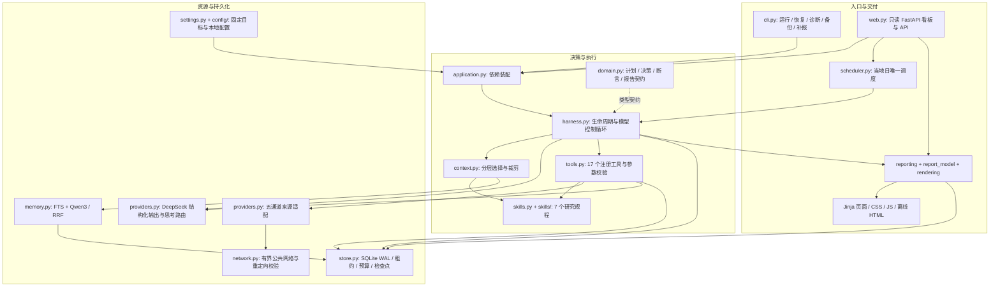
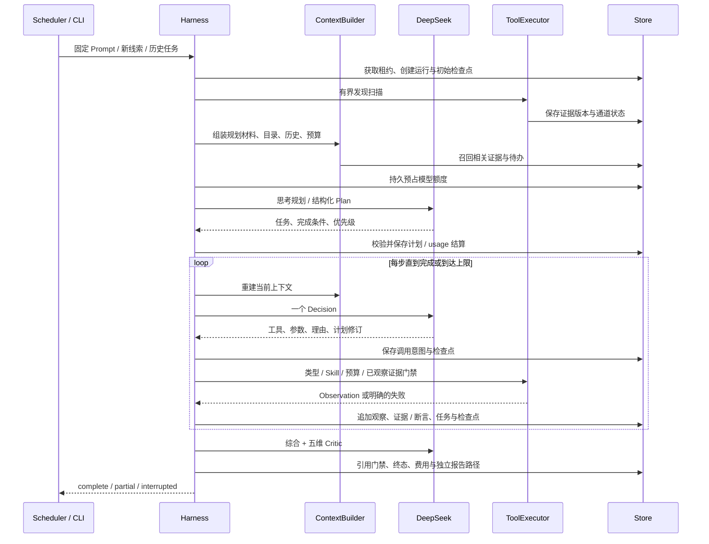
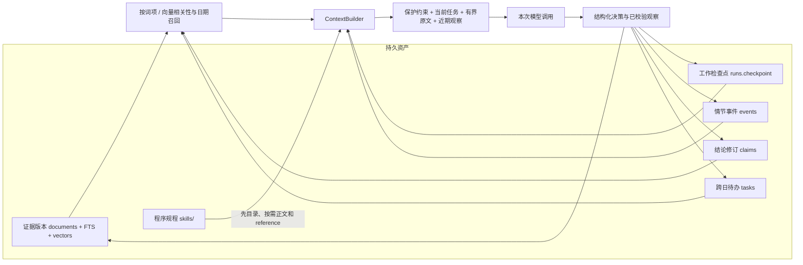
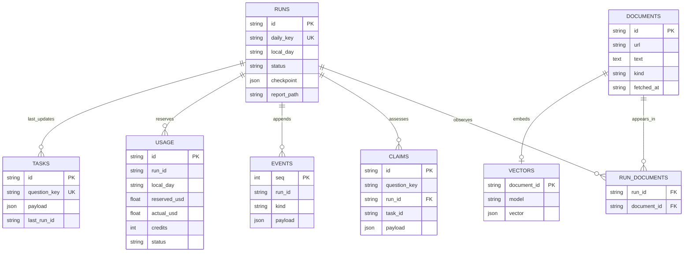
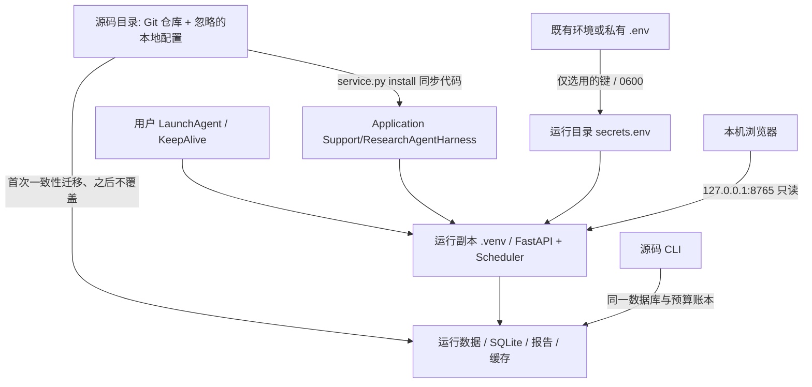

# 项目组织结构与系统图

本图对应仓库的实际单 Agent 实现。Skills 是研究规程，工具是类型化动作；Harness 负责边界与持久性，ContextBuilder 负责本次可见材料，Store 负责事务。定时器只发起固定目标，不预先规定研究动作顺序。

## 组件组织图



## 一次动作的调用时序



工具内部的外部请求同样先预占再执行。`assess_claim` 先用非思考模型；遇证据冲突时额外调用思考模型裁决。最多一次质量补查，恢复不重置原时间与预算。

## 上下文与记忆读写图



原始证据、任务约束与预算不因上下文裁剪而丢失。历史结论带日期与修订身份，不能自动升级为今日事实。未实现独立实体关系知识图谱、自动清理审计记录或自动改写 Skill。

## 数据关系



图中关系同时包含应用层逻辑关系：`tasks.last_run_id`、`events.run_id` 及 `usage.run_id` 并非全部通过数据库外键声明。FTS5 是证据搜索索引；leases 表独立管理执行租约，不表示业务事实。

## macOS 部署结构



退出终端不影响 LaunchAgent。退出登录、关机及睡眠期间不承诺执行；恢复到点后只补当天尚未建立的定时运行。默认便携配置不启用调度，已部署机器的配置在被忽略的本地文件中单独维护。

## 完整源码目录

下列清单包含版本库内容，不包含凭据、运行数据、缓存、本地配置或生成的 LaunchAgent。

```text
research-agent-harness/
├── .github/
│   └── workflows/
│       └── check.yml
├── config/
│   ├── demo.yaml
│   ├── settings.yaml
│   └── watchlist.yaml
├── docs/
│   ├── images/
│   │   ├── dashboard.jpg
│   │   ├── report-mobile.jpg
│   │   └── report.jpg
│   ├── architecture.md
│   ├── operations.md
│   ├── reports.md
│   ├── skills.md
│   ├── structure.md
│   └── validation.md
├── evals/
│   └── cases.json
├── examples/
│   ├── README.md
│   ├── demo-report.html
│   ├── demo-report.md
│   └── demo-report.report.json
├── scripts/
│   ├── live_smoke.py
│   ├── package_source.py
│   └── service.py
├── skills/
│   ├── benchmark-verification/
│   │   ├── references/
│   │   │   └── comparison.md
│   │   └── SKILL.md
│   ├── dataset-profiling/
│   │   └── SKILL.md
│   ├── ecosystem-research/
│   │   └── SKILL.md
│   ├── evidence-review/
│   │   └── SKILL.md
│   ├── memory-recall/
│   │   └── SKILL.md
│   ├── research-planning/
│   │   └── SKILL.md
│   └── web-research/
│       ├── references/
│       │   └── routing.md
│       └── SKILL.md
├── src/
│   └── research_agent/
│       ├── static/
│       │   ├── app.css
│       │   ├── app.js
│       │   └── favicon.svg
│       ├── templates/
│       │   ├── about.html
│       │   ├── base.html
│       │   ├── error.html
│       │   ├── evidence.html
│       │   ├── macros.html
│       │   ├── overview.html
│       │   ├── report.html
│       │   ├── report_body.html
│       │   ├── reports.html
│       │   ├── skills.html
│       │   ├── source.html
│       │   └── standalone.html
│       ├── __init__.py
│       ├── application.py
│       ├── cli.py
│       ├── context.py
│       ├── demo.py
│       ├── domain.py
│       ├── errors.py
│       ├── evaluation.py
│       ├── harness.py
│       ├── logging_config.py
│       ├── memory.py
│       ├── network.py
│       ├── providers.py
│       ├── rendering.py
│       ├── report_model.py
│       ├── reporting.py
│       ├── scheduler.py
│       ├── settings.py
│       ├── skills.py
│       ├── store.py
│       ├── tools.py
│       └── web.py
├── tests/
│   ├── conftest.py
│   ├── test_budget_memory.py
│   ├── test_context_provider_web.py
│   ├── test_harness.py
│   ├── test_network_tools.py
│   ├── test_report_center.py
│   ├── test_retrieval_reporting.py
│   └── test_sources.py
├── .env.example
├── .gitignore
├── AGENTS.md
├── README.md
├── pyproject.toml
└── uv.lock
```

运行后生成的 `data/`、`reports/`、`.venv/` 和 `config/settings.local.yaml` 不在上述版本库中。
